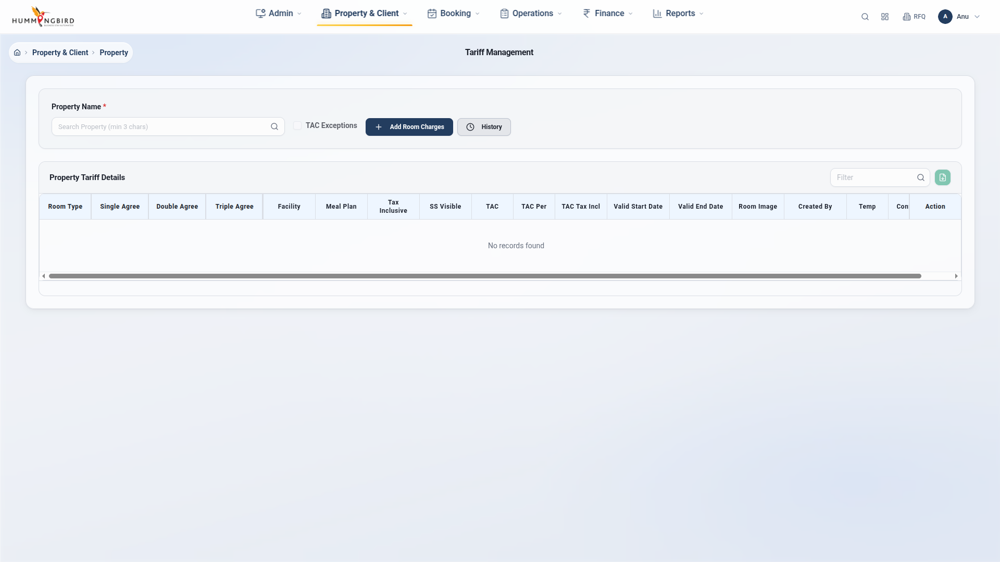

# 🎨 Bug Screenshot Annotation System

## Overview

This system automatically annotates bug screenshots with visual markers to clearly show what the bug is, where it's located, and what the expected behavior should be.

## 📁 Directory Structure

```
Tariff_Management/
├── assets/
│   ├── bugs/                      # Original screenshots
│   ├── bugs_annotated/            # Annotated screenshots with markers
│   └── screenshots/               # General test screenshots
├── utils/
│   ├── bug_annotator.py          # Annotation engine
│   └── bug_annotation_config.py  # Bug annotation definitions
├── annotate_bugs.py              # Batch annotation script
└── bug_screenshots_comparison.html  # Visual comparison page
```

## 🎯 Features

### Annotation Types

1. **Red Rectangles** - Highlight the main bug area
2. **Red Circles** - Point to specific UI elements
3. **Arrows** - Direct attention to problems
4. **Text Labels** - Explain what's wrong
5. **Banner** - Bug ID and description at top
6. **Color Coding**:
   - 🔴 Red: Main issues
   - 🟠 Orange: Warnings/secondary issues
   - 🟢 Green: Expected/correct behavior

### Example Annotations

#### Bug #1: Checkbox Not Visible
```
Banner: "BUG #1: TAC Exceptions Checkbox Not Clearly Visible"
- Red rectangle around checkbox area
- Text: "❌ Checkbox barely visible"
- Text: "→ Needs larger size + better contrast"
- Arrow pointing to checkbox
```

#### Bug #12: Date Mismatch
```
Banner: "BUG #12: To Date Display Wrong (DB=13/03/2026, Screen=28/02/2027)"
- Red rectangle around date field
- Text: "❌ Showing: 28/02/2027"
- Text: "✅ Should be: 13/03/2026"
- Text: "⚠️  UI-DB mismatch!"
```

## 🚀 Usage

### 1. Annotate Existing Screenshots

```bash
# Run the batch annotation script
python3 annotate_bugs.py
```

This will:
- ✅ Find all bug screenshots in `assets/bugs/`
- ✅ Annotate them based on `bug_annotation_config.py`
- ✅ Save annotated versions to `assets/bugs_annotated/`
- ✅ Generate `bug_screenshots_comparison.html`

### 2. Annotate During Test Execution

Add to your test file:

```python
from tests.conftest_screenshot import AnnotatedScreenshot

def test_bug_example(logged_in_page: Page):
    # Create annotated screenshot helper
    screenshot = AnnotatedScreenshot(logged_in_page)
    
    # Navigate to bug state
    logged_in_page.click("text=TAC Exceptions")
    
    # Capture and auto-annotate
    original, annotated = screenshot.capture_bug(
        bug_name='bug_01_checkbox_not_visible',
        auto_annotate=True
    )
    
    # Now you have both:
    # - Original: assets/bugs/bug_01_checkbox_not_visible_20260929_120000.png
    # - Annotated: assets/bugs_annotated/bug_01_checkbox_not_visible_ANNOTATED_20260929_120000.png
```

### 3. View Comparison Page

```bash
# Open in browser
firefox bug_screenshots_comparison.html
# or
google-chrome bug_screenshots_comparison.html
```

The comparison page shows:
- ✅ Side-by-side original vs annotated
- ✅ Click to zoom full-size
- ✅ Bug descriptions
- ✅ Annotation legend
- ✅ Statistics (total bugs, annotated count)

## 📝 Adding New Bug Annotations

Edit `utils/bug_annotation_config.py`:

```python
BUG_ANNOTATIONS = {
    "bug_99_your_bug_name": {
        "banner": "BUG #99: Brief Description",
        "description": "Detailed explanation of the bug",
        
        # Rectangles (highlight areas)
        "rectangles": [
            {"coords": (x, y, width, height), "color": "red", "thickness": 5}
        ],
        
        # Circles (point to specific elements)
        "circles": [
            {"coords": (center_x, center_y, radius), "color": "red"}
        ],
        
        # Arrows (point from label to bug)
        "arrows": [
            {"start": (x1, y1), "end": (x2, y2), "color": "red"}
        ],
        
        # Text labels
        "texts": [
            {
                "text": "❌ What's wrong",
                "position": (x, y),
                "color": "red",
                "font_size": "medium"  # 'small', 'medium', 'large'
            },
            {
                "text": "✅ Expected behavior",
                "position": (x, y),
                "color": "green"
            }
        ]
    }
}
```

### Coordinate System

- **Origin**: Top-left corner (0, 0)
- **X-axis**: Increases to the right
- **Y-axis**: Increases downward

### Finding Coordinates

1. Open screenshot in image editor (GIMP, Paint, etc.)
2. Hover mouse over area to annotate
3. Note the X,Y coordinates
4. Add to config

**Pro Tip**: Start with approximate coordinates and adjust after seeing the result.

## 🎨 Customization

### Colors Available

```python
colors = {
    'red': '#FF0000',      # Errors, main issues
    'orange': '#FF6600',   # Warnings, secondary
    'yellow': '#FFFF00',   # Caution
    'green': '#00FF00',    # Expected behavior
    'blue': '#0000FF',     # Information
    'white': '#FFFFFF',    # Background
    'black': '#000000'     # Outlines
}
```

### Font Sizes

- `'small'` - 20pt
- `'medium'` - 30pt (default)
- `'large'` - 40pt

## 📊 Current Coverage

### Annotated Bugs (70 screenshots)
- ✅ Bug #1: Checkbox visibility
- ✅ Bug #2: Filter initial space
- ✅ Bug #3: Table header caps
- ✅ Bug #4: Table heading mismatch
- ✅ Bug #5: Tooltip missing
- ✅ Bug #6: Design background
- ✅ Bug #7: Error message
- ✅ Bug #8: Date picker alignment
- ✅ Bug #9: Room image fit
- ✅ Bug #10: Alignment issue
- ✅ Bug #11: Tooltip room charge
- ✅ Bug #12: To date wrong
- ✅ Bug #13: Tariff length
- ✅ Bug #14: Pagination
- ✅ Bug #15: TAC percentage
- ✅ Bug #16: Date manual edit
- ✅ Bug #17: Filter not cleared
- ✅ Bug #18: Design overlaps
- ✅ Bug #19: Firefox issue
- ✅ Bug #20: Room image text
- ✅ Bug #21-22: Additional bugs

### Pending Configuration (54 screenshots)
Bugs #23-42 need annotation config to be added.

## 🔧 Maintenance

### Re-annotate All Screenshots

```bash
# Delete existing annotations
rm -rf assets/bugs_annotated/

# Re-run annotation
python3 annotate_bugs.py
```

### Update Existing Annotation

1. Edit `utils/bug_annotation_config.py`
2. Delete specific annotated screenshot from `assets/bugs_annotated/`
3. Run `python3 annotate_bugs.py` again

## 💡 Best Practices

### DO ✅
- Use red for main issues
- Use green for expected behavior
- Add clear, concise text labels
- Include both "what's wrong" and "what should be"
- Test annotations on actual screenshots

### DON'T ❌
- Overload with too many annotations
- Use vague descriptions
- Forget to add banner with bug ID
- Place text over busy backgrounds (use background=True)

## 📸 Screenshot Examples

### Before Annotation


### After Annotation


The annotated version clearly shows:
- 🔴 Where the bug is
- 📝 What the problem is
- ✅ What should happen instead

## 🎯 Benefits

1. **Clarity**: Anyone can understand the bug at a glance
2. **Communication**: Better bug reports for developers
3. **Documentation**: Visual record of issues
4. **Training**: New team members can see common problems
5. **Comparison**: Easy before/after review

## 🔍 Troubleshooting

### Annotation Not Appearing
- Check bug_name matches config key exactly
- Verify coordinates are within screenshot bounds
- Check for typos in color names

### Text Not Readable
- Use `background=True` in text config
- Choose contrasting colors
- Increase font_size

### Wrong Position
- Review coordinate system (0,0 is top-left)
- Use image editor to find exact coordinates
- Adjust and re-run annotation

## 📚 Related Files

- `utils/bug_annotator.py` - Core annotation engine
- `utils/bug_annotation_config.py` - All bug definitions
- `tests/conftest_screenshot.py` - Test integration
- `annotate_bugs.py` - Batch processing script
- `bug_screenshots_comparison.html` - Visual comparison

---

**Status**: ✅ System Operational
**Bugs Annotated**: 70 screenshots (20 unique bugs)
**Pending Config**: 54 screenshots (bugs #23-42)

**Next Steps**:
1. Open `bug_screenshots_comparison.html` in browser
2. Review annotated screenshots
3. Add configuration for remaining bugs
4. Re-run `python3 annotate_bugs.py`
